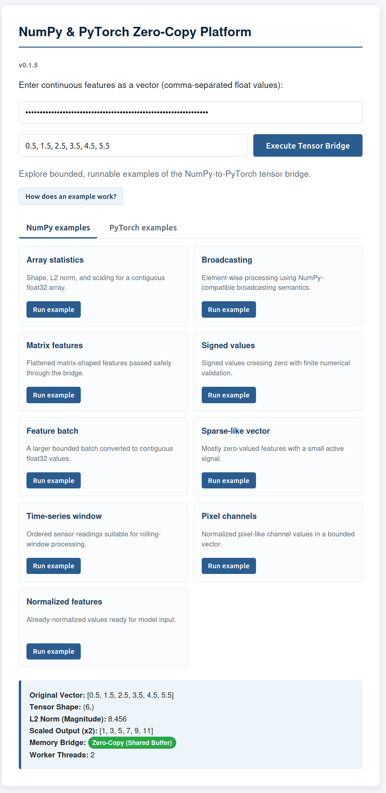
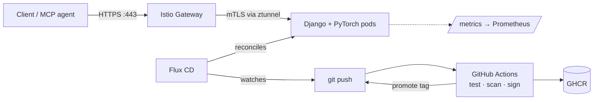

<div align="center">

# kube-ml

**A hardened, cloud-native reference platform for serving NumPy & PyTorch tensor workloads on Kubernetes.**

Zero-copy tensor bridge · Istio Ambient mTLS · Flux GitOps · PSS Restricted · MCP server

[](https://github.com/ManuJacks/kube-ml/actions/workflows/ci.yml)

[Quick start](#quick-start) · [Architecture](#architecture) · [Docs](docs/README.md) · [Status](#status)

</div>



_The interactive GUI provides runnable, bounded examples and reports the zero-copy tensor result._

---

## Why this exists

Most ML-serving demos stop at `docker run`. **kube-ml** shows the whole path: a small Django
service that bridges NumPy and PyTorch without copying, wrapped in the guardrails ML workloads
actually need in a cluster (CPU and memory limits, request-size ceilings) and shipped through a
signed, GitOps-driven delivery pipeline with a zero-trust security posture.

It is a **reference implementation** for learning, demos, and as a starting point, not a
turnkey production service. See [Status](#status) for exactly what is and isn't covered.

## Highlights

| | |
| --- | --- |
| **Zero-copy tensor bridge** | `torch.from_numpy()` over C-contiguous `float32` arrays shares memory between NumPy and PyTorch |
| **Container-aware limits** | `torch.set_num_threads(2)` prevents CPU thrashing in pods; `MAX_ELEMENTS = 1,000,000` and a 25 MB body cap bound each request |
| **MCP server** | `numpy-mcp-server` exposes 20 read-only examples to AI agents over stdio |
| **Istio Ambient mesh** | Sidecar-free strict mTLS and HTTPS gateway termination via the Gateway API |
| **Flux CD GitOps** | Continuous reconciliation with pruning; immutable, auto-promoted image tags |
| **Zero-trust hardening** | Default-deny NetworkPolicies, least-privilege RBAC, Pod Security Standards *Restricted*, read-only rootfs |
| **Supply-chain checks** | Tests, Ruff, Helm/Kustomize rendering, `pip-audit`, Trivy, SPDX SBOM, keyless Cosign signing |
| **Operability** | Health and readiness probes, Prometheus metrics, HPA autoscaling |

## Architecture



More diagrams and the repository layout are in [docs/architecture.md](docs/architecture.md).

## Quick start

Requires Python 3.10+.

```bash
make venv && make install

# Protected endpoints need a bearer token
export KUBE_ML_API_TOKEN="$(openssl rand -hex 32)"
printf 'KUBE_ML_API_TOKEN=%s\n' "$KUBE_ML_API_TOKEN" > .env.local

make test       # run the test suite
make run-dev    # http://localhost:8000
```

Try the API:

```bash
curl -X POST http://localhost:8000/predict \
  -H "Authorization: Bearer $KUBE_ML_API_TOKEN" \
  -H "Content-Type: application/json" \
  -d '{"data": [10.0, 20.0, 30.0, 40.0]}'
```

Or open <http://localhost:8000/> for the interactive UI and paste your token into the password
field.

### On Kubernetes

```bash
minikube start --driver=docker
eval $(minikube docker-env)
docker build -t kube-ml-app:v1 .
kubectl apply -k clusters/minikube/apps
```

Full walkthroughs: [Minikube](docs/kubernetes-minikube.md) ·
[HTTPS via Istio](docs/service-mesh.md) · [Flux GitOps](docs/gitops-and-delivery.md)

## API

| Method | Path | Auth | Purpose |
| --- | --- | :---: | --- |
| `POST` | `/predict` | yes | Tensor computation |
| `GET` | `/api/v1/examples` | yes | Deterministic examples and limits |
| `GET` | `/metrics` | yes | Prometheus metrics |
| `GET` | `/healthz` | no | Liveness (includes app version) |
| `GET` | `/readyz` | no | Readiness |

Full contract: [`docs/openapi.yaml`](docs/openapi.yaml).

## Documentation

| Guide | Topic |
| --- | --- |
| [Architecture](docs/architecture.md) | Diagrams and repository layout |
| [Local development](docs/local-development.md) | Setup, tests, endpoints, MCP server |
| [Kubernetes on Minikube](docs/kubernetes-minikube.md) | Build, deploy, access |
| [Minikube restart runbook](docs/restart-runbook.md) | Repeatable restart, repair modes, and GUI validation |
| [Service mesh & HTTPS](docs/service-mesh.md) | Istio Ambient, mTLS, gateway access |
| [GitOps & delivery](docs/gitops-and-delivery.md) | Flux, CI pipeline, image promotion |
| [Security hardening](docs/security-hardening.md) | Network policy, RBAC, PSS, supply chain |
| [Authentication](docs/authentication.md) | Bearer tokens and rotation |
| [Roadmap](docs/roadmap.md) | What's left for production |

## Status

| Area | State |
| --- | --- |
| Tensor API, MCP server, UI | Working, tested |
| Bearer-token auth | Implemented (single shared token) |
| Mesh, NetworkPolicy, PSS, RBAC | Defined as manifests |
| CI, SBOM, Cosign signing, GitOps promotion | Running in the pipeline |
| Signature admission enforcement | Not yet enforced in-cluster |
| OIDC/JWT, tenancy, quotas, SLOs, backups | Not yet implemented |
| Ephemeral-cluster end-to-end tests | Planned |

Treat this as a hardened reference, not a production-certified, internet-facing platform. The
[roadmap](docs/roadmap.md) lists what remains.
