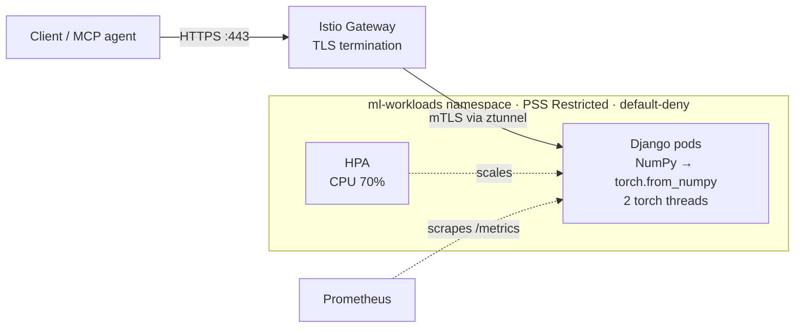
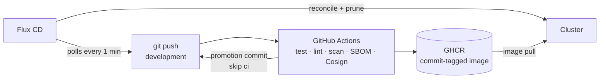

# Architecture

## Request path



## Delivery path



## Repository structure

Abridged; see the repository for the full tree (Helm chart, additional manifests, and so on).

```text
.
├── .github/workflows/ci.yml         # CI/CD: tests, lint, scan, build, sign, promote
├── pyproject.toml                   # Build metadata & entry points
├── Makefile                         # Automation targets
├── Dockerfile                       # Lean container build
├── manage.py                        # Django management script
├── config/                          # Django project configuration
│   ├── settings.py                  # Core settings & request-size limits
│   ├── urls.py                      # Root routing
│   └── wsgi.py                      # WSGI entry point
├── core/                            # Tensor application
│   ├── views.py                     # Zero-copy tensor bridge & endpoints
│   ├── urls.py                      # Route declarations
│   ├── tests.py                     # Unit & integration tests
│   └── templates/core/
│       └── tensor_gui.html          # Interactive GUI
├── mcp/
│   └── server.py                    # Model Context Protocol server
├── docs/                            # Documentation (this folder), incl. openapi.yaml
└── clusters/minikube/               # GitOps & Kubernetes manifests
    ├── apps/
    │   ├── kustomization.yaml
    │   ├── deployment.yaml
    │   ├── service.yaml
    │   ├── hpa.yaml
    │   └── hardened-manifest.yaml   # PSS Restricted, NetworkPolicies, ServiceAccount
    └── flux-system/
        ├── kustomization.yaml
        └── gotk-sync.yaml           # Flux source & sync
```
